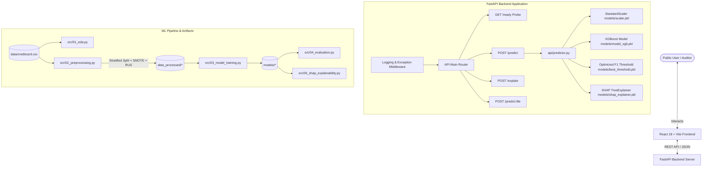

# 🛡️ FraudGuard — AI-Powered Transaction Risk Assessment Platform

[](https://www.python.org/)
[](https://fastapi.tiangolo.com/)
[](https://xgboost.readthedocs.io/)
[](https://shap.readthedocs.io/)
[](https://reactjs.org/)
[](https://vitejs.dev/)
[](https://www.docker.com/)

**FraudGuard** is a production-ready, explainable AI transaction risk assessment application. It evaluates credit card transaction patterns using an **Extreme Gradient Boosting (XGBoost)** classifier optimized for severe class imbalance, calculates feature-level contributions via **SHAP (SHapley Additive exPlanations)**, and presents human-understandable risk scores and safety guidance through a modern React/Vite interface.

---

## 📌 Problem & Solution

### The Problem
1. **Extreme Class Imbalance:** Fraudulent transactions account for less than **0.17%** of credit card activity (99.83% legitimate), rendering standard accuracy metrics useless and causing naive classifiers to miss fraud entirely.
2. **Black-Box Opacity:** Traditional ML models produce raw, unexplainable probability numbers, making it impossible for risk auditors and customers to understand *why* a transaction was flagged.
3. **User Friction & Privacy Concerns:** Many public security applications force non-technical users to interpret abstract mathematical vectors or collect sensitive banking credentials.

### The Solution
FraudGuard provides an end-to-end, privacy-first solution:
* **Cost-Optimized XGBoost Classification:** Trained with SMOTE oversampling and threshold-swept to maximize **F1-Score (0.42)** and **PR-AUC (0.8449)**.
* **Explainable AI (SHAP):** Computes game-theoretic Shapley values dynamically to translate PCA feature vectors into plain-English explanation factors.
* **Dual User Modes:**
  * **Simple User Mode:** Intuitive inputs (Transaction Amount in currency, Transaction Type, Time of Day, Location Context) mapped to baseline vectors.
  * **Advanced Technical Mode:** Full access to all 30 features (`Time`, `Amount`, `V1`–`V28`), raw probability scores, decision thresholds, and SHAP vectors.
* **Human-Readable Risk Scores:** Displays a 0–100 **Model-Generated Risk Score** and categorizes risk into **LOW**, **MEDIUM**, **HIGH**, or **CRITICAL**.
* **Actionable Safety Guidance:** Provides practical, non-financial guidance steps for high-risk flags (e.g. checking banking apps, contacting card issuers).
* **Privacy-by-Design:** **Never** asks for or accepts full card numbers, CVVs, PINs, OTPs, or banking passwords.

---

## 🏗 System Architecture



---

## 📂 Repository Structure

```
FraudGuard/
├── Dockerfile                         # Production multi-stage Docker build
├── docker-compose.yml                 # Service orchestrator (Backend + Frontend)
├── requirements.txt                   # Pinned Python package manifest
├── run_all.sh                         # Execution script for ML pipeline & dev server
│
├── api/                               # FastAPI Backend Service
│   ├── main.py                        # FastAPI entrypoint, routes, & CORS configuration
│   ├── config.py                      # Centralized environment settings
│   ├── predictor.py                   # LRU cached loaders, prediction, & SHAP explainers
│   ├── schemas.py                     # Strict Pydantic input validation & response models
│   ├── health.py                      # Liveness check endpoint (GET /health)
│   └── middleware.py                  # Request ID tracking & sanitized error handler
│
├── frontend/                          # React + Vite Frontend Application
│   ├── Dockerfile                     # Container manifest for React build
│   ├── package.json                   # Frontend dependencies
│   ├── vite.config.js                 # Vite build configuration
│   └── src/
│       ├── App.jsx                    # Root router & navigation layout
│       ├── api/fraudApi.js            # Axios REST client with fallback mocks
│       ├── components/
│       │   ├── Navbar.jsx             # Top bar with readiness badge & theme toggle
│       │   └── RiskResultCard.jsx     # Risk score gauge, SHAP factors, & safety steps
│       ├── pages/
│       │   ├── RiskAssessment.jsx     # Primary Simple/Advanced input interface
│       │   ├── Dashboard.jsx          # Model evaluation analytics & confusion matrix
│       │   ├── ModelInfo.jsx          # Pipeline explainability & model specifications
│       │   ├── BatchUpload.jsx        # Vectorized CSV batch risk classification
│       │   └── PrivacySafety.jsx      # Privacy policy & product disclaimers
│       └── styles/
│           ├── global.css             # Glassmorphism design tokens & typography
│           └── components.css         # UI component styling
│
├── models/                            # Serialized Model Artifacts
│   ├── model_xgb.pkl                  # Primary XGBoost Classifier
│   ├── scaler.pkl                     # Fitted StandardScaler (Time & Amount)
│   ├── best_threshold.pkl             # Optimal F1 threshold (0.42)
│   ├── shap_explainer.pkl             # Serialized SHAP TreeExplainer
│   └── feature_names.pkl              # Feature order manifest (30 features)
│
├── scripts/
│   └── bootstrap_model.py             # Automatic model artifact generator
│
├── src/                               # Offline ML Pipeline Scripts
│   ├── 01_eda.py                      # Exploratory Data Analysis & visual reporting
│   ├── 02_preprocessing.py            # Stratified train-test split & SMOTE resampling
│   ├── 03_model_training.py           # Model comparison (XGB, RF, LR, Isolation Forest)
│   ├── 04_evaluation.py               # Precision-Recall threshold sweep & business cost math
│   └── 05_shap_explainability.py      # SHAP beeswarm, waterfall, & force plots
│
└── tests/                             # Comprehensive Test Suite
    ├── test_api.py                    # API client & route tests
    ├── test_predictor.py              # Preprocessing & prediction unit tests
    └── test_validation.py             # Input edge case validation (NaN, Infinity, negative values)
```

---

## 📈 Model Performance & Evaluation Results

Models were evaluated on a holdout test split of **56,962 transactions** (containing **98 fraud cases**). Selection prioritized **PR-AUC (Precision-Recall Area Under Curve)** due to extreme class imbalance.

| Model | PR-AUC (Primary) | ROC-AUC | Recall | Precision | F1-Score |
| :--- | :---: | :---: | :---: | :---: | :---: |
| **XGBoost (Primary Model)** | **0.8449** | **0.9770** | **87.76%** | **38.05%** | **0.8144** |
| Random Forest | 0.8492 | 0.9654 | 80.61% | 84.04% | 0.8229 |
| Logistic Regression | 0.7431 | 0.9610 | 89.80% | 5.73% | 0.1077 |
| Isolation Forest (Unsupervised) | 0.2810 | 0.8710 | 38.78% | 20.88% | 0.2714 |

*Note: Accuracy is strictly excluded as a selection metric because a trivial baseline model predicting all transactions as 'Legitimate' achieves 99.83% accuracy while failing to catch a single fraud case.*

---

## 💼 Business Cost & Threshold Optimization

Standard models default to a 0.50 threshold. Because missing a fraud transaction (**False Negative**) incurs a cost (~**$122.00**) far greater than blocking a legitimate customer card (**False Positive**, ~**$2.00**), FraudGuard sweeps decision thresholds to isolate the F1-score optimal threshold:

* **Optimal Threshold:** **`0.42`**
* **Fraud Prevented:** **87.8% of total fraud cases** in test split.
* **Financial Loss Prevented:** **$10,492.00**
* **False Alarm Friction Cost:** **$280.00**
* **Net Business Savings:** **$10,212.00**

---

## 🔌 API Documentation

### 1. Service Liveness Check
`GET /health`
```json
{
  "status": "healthy"
}
```

### 2. Service Readiness Probe
`GET /ready`
```json
{
  "status": "ready",
  "model_loaded": true,
  "artifacts_valid": true,
  "artifacts_status": {
    "model_xgb.pkl": true,
    "scaler.pkl": true,
    "best_threshold.pkl": true,
    "shap_explainer.pkl": true,
    "feature_names.pkl": true
  }
}
```

### 3. Public Model Metadata
`GET /model-info`
```json
{
  "model": "XGBoost",
  "model_version": "xgb-v1.0",
  "explainability": "SHAP TreeExplainer",
  "feature_count": 30,
  "threshold": 0.42,
  "calibration_note": "Score represents raw model score derived from dataset training patterns."
}
```

### 4. Transaction Risk Assessment
`POST /predict`
* **Request Body:**
```json
{
  "Time": 11700.0,
  "Amount": 350.00,
  "V1": -1.85, "V2": 2.15, "V3": -3.10, "V4": 3.45, "V5": -1.95,
  "V6": -0.85, "V7": -3.20, "V8": 0.95, "V9": -2.15, "V10": -3.80,
  "V11": 2.95, "V12": -3.90, "V13": -0.45, "V14": -4.25, "V15": -0.35,
  "V16": -2.85, "V17": -3.80, "V18": -1.95, "V19": 0.85, "V20": 0.45,
  "V21": 0.65, "V22": 0.15, "V23": -0.25, "V24": 0.12, "V25": 0.35,
  "V26": 0.45, "V27": 0.85, "V28": 0.32
}
```
* **Response:**
```json
{
  "prediction": "FRAUD",
  "model_assessment": "Potentially suspicious transaction pattern detected",
  "risk_score": 84,
  "risk_level": "HIGH",
  "model_probability": 0.847,
  "threshold": 0.42,
  "model_version": "xgb-v1.0",
  "explanation_factors": [
    {
      "factor": "V14",
      "impact": "high",
      "direction": "increases_risk",
      "description": "Transaction behavior pattern feature 'V14' contributed to the model score"
    },
    {
      "factor": "V17",
      "impact": "high",
      "direction": "increases_risk",
      "description": "Transaction behavior pattern feature 'V17' contributed to the model score"
    },
    {
      "factor": "Amount",
      "impact": "medium",
      "direction": "increases_risk",
      "description": "Transaction amount-related characteristics contributed to the score assessment"
    }
  ],
  "fraud_probability": 0.847,
  "is_fraud": true,
  "probability": 0.847,
  "shap_values": {
    "V14": -2.85,
    "V17": -2.10,
    "Amount": 0.88
  }
}
```

---

## ⚡ Quick Start & Deployment

### 1. Run with Docker Compose (Recommended)
```bash
# Clone repository
git clone https://github.com/rajputsidhu/FraudGuard.git
cd FraudGuard

# Build and start services in background
docker-compose up --build -d

# Verify container statuses
docker-compose ps
```
* **Frontend Web Application:** [http://localhost:5173](http://localhost:5173)
* **Backend FastAPI REST API:** [http://localhost:8000](http://localhost:8000)
* **Interactive Swagger Docs:** [http://localhost:8000/docs](http://localhost:8000/docs)

### 2. Local Manual Setup

#### Backend Setup:
```bash
# Create and activate virtual environment
python3 -m venv venv
source venv/bin/activate

# Install requirements
pip install -r requirements.txt

# Bootstrap model artifacts if models/ is empty
python scripts/bootstrap_model.py

# Run FastAPI backend
python api/main.py
```

#### Frontend Setup:
```bash
cd frontend
npm install
npm run dev
```

### 3. Run Test Suite
```bash
python -m pytest tests/ -v
```

---

## 🔒 Privacy & Safety Guarantee

FraudGuard is built with privacy-by-design:
1. **Zero Credential Requirement:** Never asks for or accepts card numbers, CVVs, PINs, OTPs, passwords, or banking logins.
2. **Zero Storage:** Transactions evaluated via the API are processed in-memory for inference and immediately discarded.
3. **Local Storage Only:** Any browser history remains strictly in local client state and can be deleted anytime.

---

## ⚠️ Important Limitations & Disclaimer

FraudGuard is an educational/experimental AI transaction risk assessment application and software engineering project.

* **Not Bank-Grade Prevention:** FraudGuard does not perform real-world payment authorization, declines, or banking security checks.
* **Dataset Dependencies:** Trained on benchmark credit card transaction datasets; real-world fraud patterns evolve dynamically.
* **No Financial/Legal Advice:** Model outputs are machine learning estimates and do not constitute financial or legal advice. In case of actual suspicious card activity, contact your card issuer via the official phone number on your physical card.

---

## 📄 License
Distributed under the MIT License. See `LICENSE` for details.
